# DevsBucket rebuild: architecture diagrams

Locked on 2026-11-11 (see `LOCKED.md`). Viewer page with copy buttons: https://claude.ai/artifact/CwXsQHd32RWcfxeN51MNJH (private).

**Importing into Excalidraw:** More tools → **Mermaid to Excalidraw**. Paste one block at a time, because Excalidraw takes one diagram per paste.

## 1. Tech stack

```mermaid
flowchart TB
  subgraph infra["Hosting and infrastructure"]
    direction LR
    i0a["Piece"] ~~~ i0b["Choice"]
    i1a["Server"] ~~~ i1b["Oracle Cloud Always Free ARM VM: 2 cores, 12 GB RAM, 200 GB disk, never upgrade the account"]
    i2a["Runtime"] ~~~ i2b["Docker + Docker Compose, dev and prod"]
    i3a["Reverse proxy and HTTPS"] ~~~ i3b["Caddy, automatic Let's Encrypt"]
    i4a["Domain"] ~~~ i4b["DuckDNS free subdomain"]
    i5a["File storage"] ~~~ i5b["Cloudflare R2, private bucket, 10 GB free, hard limits in the app"]
    i6a["Local storage"] ~~~ i6b["S3-compatible container that stands in for R2"]
    i7a["Backups"] ~~~ i7b["Nightly encrypted pg_dump to Oracle Object Storage"]
    i8a["CI/CD"] ~~~ i8b["GitHub Actions: tests, then SSH deploy with docker compose"]
  end
  subgraph app["Application"]
    direction LR
    a0a["Layer"] ~~~ a0b["Choice"]
    a1a["Language"] ~~~ a1b["TypeScript, Node 24 LTS"]
    a2a["Repo"] ~~~ a2b["One GitHub repo: pnpm workspaces + Turborepo, apps web, realtime, worker + shared packages"]
    a3a["Web"] ~~~ a3b["Next.js App Router"]
    a4a["UI"] ~~~ a4b["Tailwind v4 + shadcn/ui, more component libraries if needed"]
    a5a["Client data"] ~~~ a5b["TanStack Query"]
    a6a["Forms and validation"] ~~~ a6b["react-hook-form + Zod"]
    a7a["Auth"] ~~~ a7b["Better Auth: email/password + GitHub login, invite-only sign-ups"]
    a8a["Database"] ~~~ a8b["Postgres 18 in Docker"]
    a9a["ORM and migrations"] ~~~ a9b["Drizzle + drizzle-kit"]
    a10a["Permissions"] ~~~ a10b["Shared authz package: Owner, Editor, Viewer, inherited from folders"]
    a11a["Live editing"] ~~~ a11b["Yjs + Hocuspocus, Monaco for all text files, Tiptap for rich notes"]
    a12a["Versions and diffs"] ~~~ a12b["Automatic and manual snapshots, Monaco diff editor"]
    a13a["Live events"] ~~~ a13b["WebSockets in the realtime server, driven by Postgres LISTEN/NOTIFY"]
    a14a["Background jobs"] ~~~ a14b["pg-boss worker"]
    a15a["Lint and format"] ~~~ a15b["Biome"]
    a16a["Tests"] ~~~ a16b["Vitest + Playwright"]
  end
  infra ~~~ app
```

## 2. Roles and what they can do

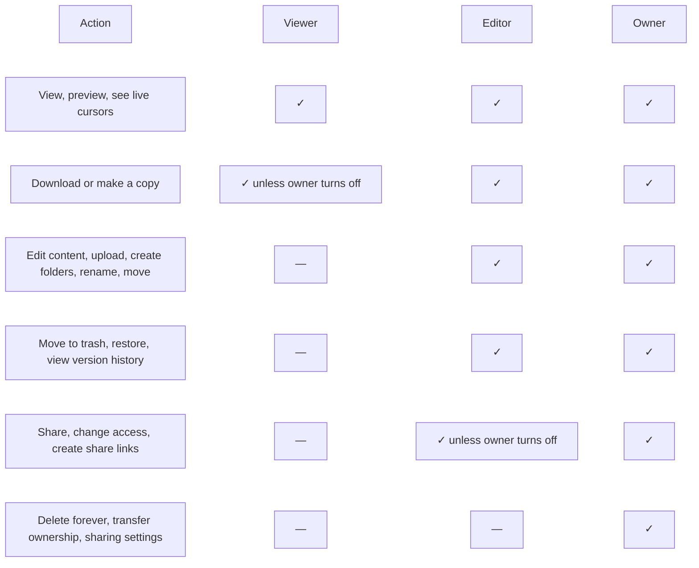

## 3. Production system

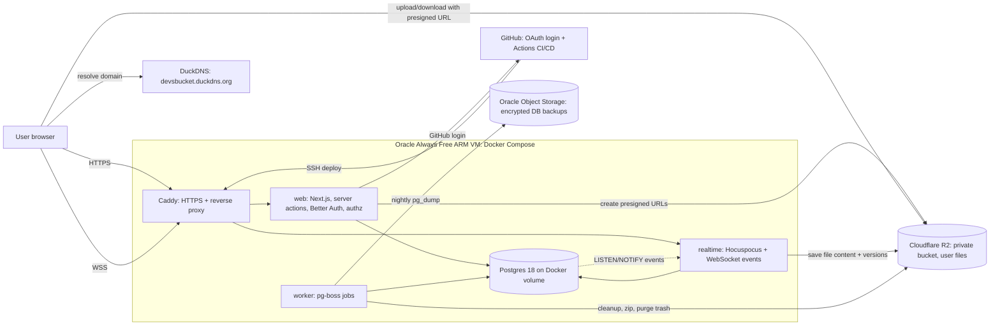

## 4. Local dev environment

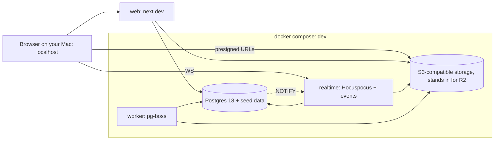

## 5. Monorepo structure

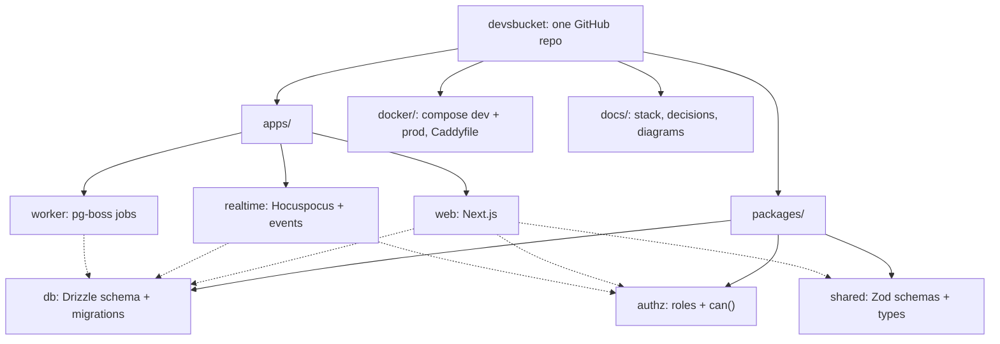

## 6. Data model

The User, Session and Account tables come from Better Auth. The User table has extra fields added.
Value sets used below:

- `Item.type`: folder, file, note
- `Item.status`: pending, ready
- `Item.trashedAt` is set on a trashed item and everything inside it; `trashRoot` marks the one the user trashed (decision 0007). Total stored bytes is `sum(User.storageUsed)`, not a counter.
- `Item.editorsCanShare` arrives with sharing in Phase 3; off on a folder means off for everything inside (decision 0008). There's no download setting: Viewers can always download (decision 0012).
- `ShareLink`: one active link per item; `ShareLinkVisit` records who opened it, and gives them the link's role while it's active (decision 0008).
- `OwnershipTransfer.status`: pending, accepted, declined, cancelled (decision 0009). `AlertState` remembers raised system alerts so they don't repeat (decision 0010).
- `role`: editor, viewer
- `AccessRequest.status`: pending, approved, denied

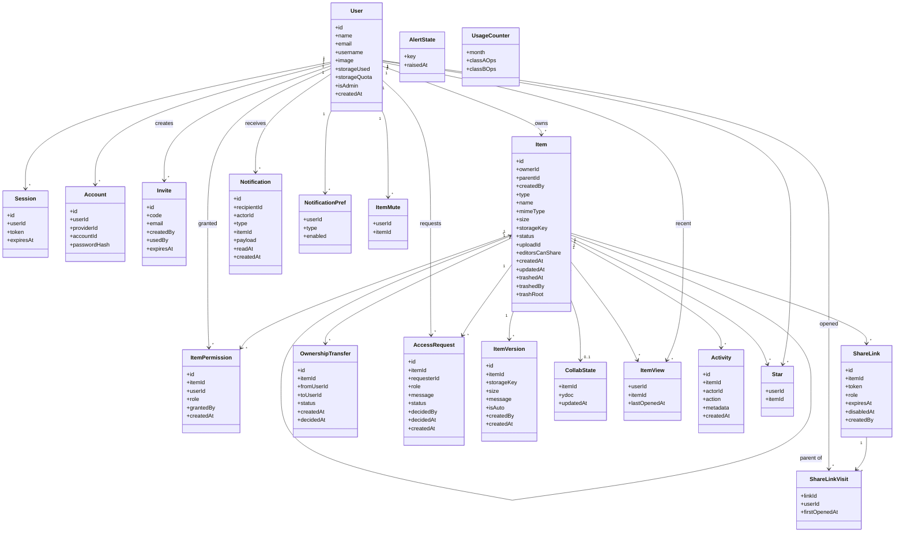

## 7. Permission check (used by web and realtime)

One SQL function, `item_access()`, does the loading and resolving (decisions 0002, 0008); `can()` decides the last step.

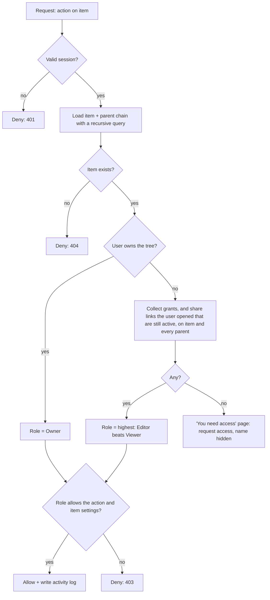

## 8. Upload

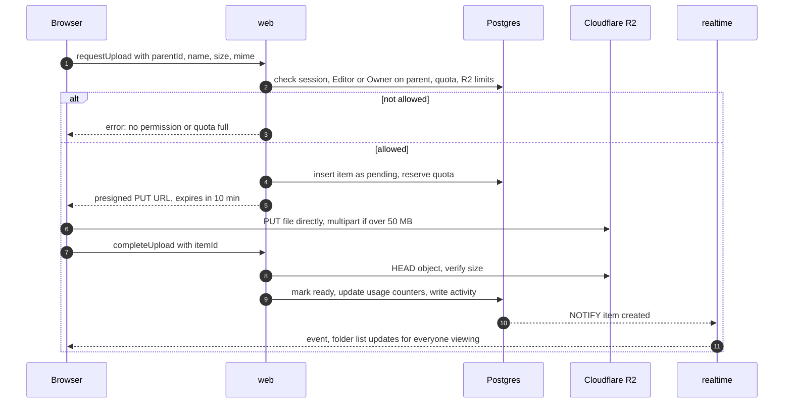

## 9. Live editing (Monaco or Tiptap)

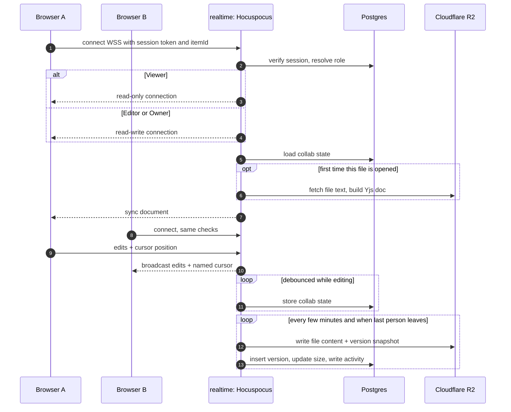

## 10. Sharing and notifications

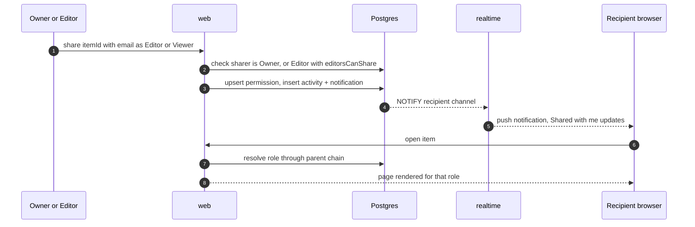

## 11. Deploy pipeline

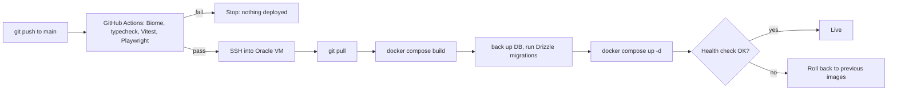
